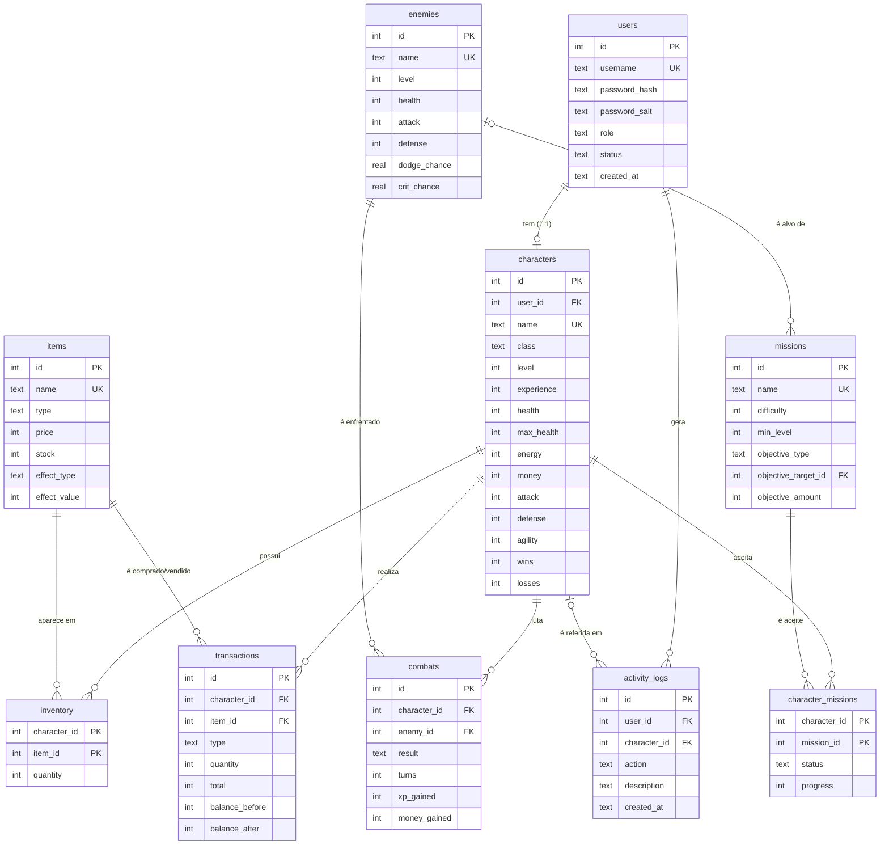

# Modelo Entidade-Relação

Imagem: [`modelo_er.png`](modelo_er.png) / [`modelo_er.svg`](modelo_er.svg)
(gerada com Graphviz a partir de [`modelo_er.dot`](modelo_er.dot): `dot -Tpng modelo_er.dot -o modelo_er.png`).

O mesmo diagrama em Mermaid (o GitHub desenha-o automaticamente):

## Relações

| Tipo | Tabelas |
|------|---------|
| 1:1  | `users` — `characters` (`user_id` é `UNIQUE`) |
| 1:N  | `characters` — `transactions`, `characters` — `combats`, `users` — `activity_logs`, `enemies` — `missions` (alvo) |
| N:N  | `characters` — `items` (tabela `inventory`), `characters` — `missions` (tabela `character_missions`) |

## Restrições de integridade principais

- `CHECK (money >= 0)`: nunca existe saldo negativo.
- `CHECK (quantity > 0)` no inventário: linhas vazias são apagadas.
- `UNIQUE` em `users.username` e `characters.name` (sem distinção de maiúsculas).
- `CHECK (...)` nos tipos/estados (`role`, `status`, `type`, `result`...).
- Chaves estrangeiras ativas (`PRAGMA foreign_keys = ON`).
